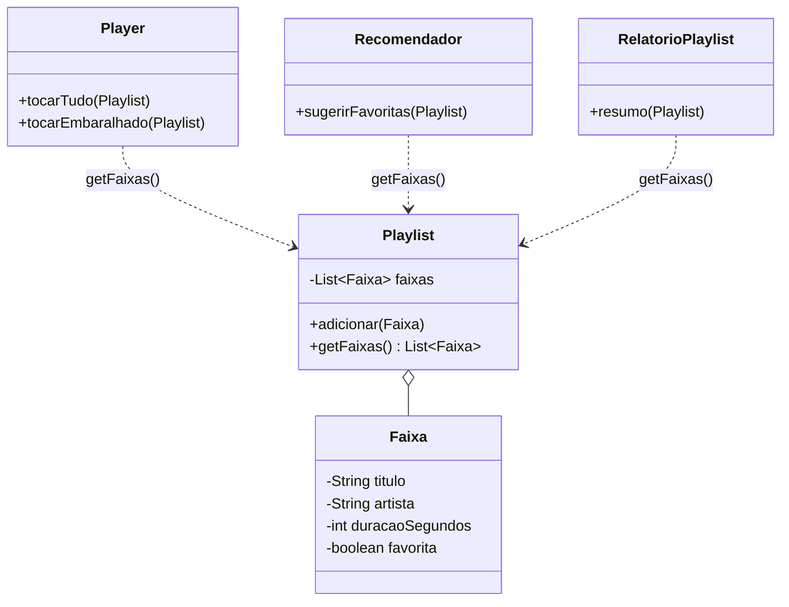
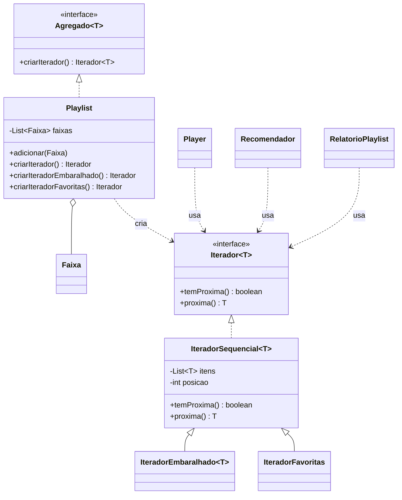

# Exercício 2: Rastreando o anti-pattern (Iterator)

Projeto: app de música com `Playlist`, `Faixa`, `Player`, `Recomendador` e `RelatorioPlaylist`.

**Conteúdo da entrega:**

1. Respostas às questões 1 a 5
2. Diagramas de classes (antes/depois)
3. Código refatorado e estrutura de pastas
4. Justificativa de cada decisão de design

---

## Parte 1: Respostas às questões

### 1. Consequências de `Playlist.getFaixas()` devolver a lista interna

`getFaixas()` devolve a **própria referência** do `ArrayList` privado, e não uma cópia nem uma visão somente leitura.

**Consequências para o encapsulamento:**

- **Encapsulamento quebrado:** qualquer cliente pode chamar `add`, `remove`, `clear`, `sort` ou `shuffle` e alterar a playlist sem passar por ela. O modificador `private` perde o sentido.
- **A `Playlist` perde o controle das suas invariantes:** ela não consegue validar entradas, impedir duplicatas nem reagir a mudanças.
- **Acoplamento ao tipo concreto:** os clientes passam a depender de a playlist ser uma `List<Faixa>` com acesso por índice (`size()` e `get(i)`).
- **Efeitos colaterais ocultos:** um cliente que só queria ler pode alterar o estado compartilhado (ver questão 2).

**Clientes que passam a depender da estrutura:**

| Cliente | Onde depende |
|---|---|
| `Player` | `tocarTudo` e `tocarEmbaralhado` |
| `Recomendador` | `sugerirFavoritas` |
| `RelatorioPlaylist` | `resumo` |
| `Main` | `println` de `playlist.getFaixas()` |

### 2. Por que a ordem original mudou após `tocarEmbaralhado`

Em `Player.tocarEmbaralhado`, o código faz:

```java
List<Faixa> faixas = playlist.getFaixas();
Collections.shuffle(faixas);
```

Como `getFaixas()` devolve a **mesma referência** da lista interna, `faixas` e o atributo `Playlist.faixas` são **o mesmo objeto**. O `Collections.shuffle` reordena esse objeto no lugar (*in place*), então a playlist fica permanentemente embaralhada. Quando o `Main` imprime a ordem de novo, ele lê a lista já alterada.

É um **efeito colateral oculto**: o cliente só queria tocar em ordem aleatória, mas acabou mudando o estado do agregado. Isso só acontece porque a estrutura interna foi exposta.

### 3. O que acontece se a `Playlist` trocar sua estrutura interna

Se a `Playlist` trocar a `List` por array, lista ligada ou páginas, o contrato de `getFaixas()` muda, ou ele precisa converter a estrutura toda vez. Os laços `for (i...) faixas.get(i)` deixam de compilar ou de fazer sentido.

**Pontos que quebram: 4 laços de travessia**

1. `Player.tocarTudo`
2. `Player.tocarEmbaralhado`
3. `Recomendador.sugerirFavoritas`
4. `RelatorioPlaylist.resumo`

O `Main` também quebra, no `println` de `getFaixas()`, o que dá 5 usos no total.

**Agravantes:**

- Cada cliente tem seu **próprio laço duplicado**, então cada um precisa ser corrigido separadamente.
- Com lista ligada, `get(i)` é O(n) e os laços por índice viram **O(n²)**.
- Com páginas, o índice linear nem existe diretamente.

### 4. Refatoração com o padrão Iterator

A proposta completa (interface de iterador, iterador concreto e agregado) está na **Parte 3**. Resumo dos papéis:

| Papel no Iterator | Classe |
|---|---|
| Interface de iterador (`temProxima()`/`proxima()`) | `Iterador<T>` |
| Iterador concreto que guarda a posição | `IteradorSequencial<T>` (e as variantes `IteradorEmbaralhado`, `IteradorFavoritas`) |
| Interface do agregado | `Agregado<T>` |
| Agregado que cria o iterador | `Playlist` |
| Clientes | `Player`, `Recomendador`, `RelatorioPlaylist`, `Main` |

### 5. Como a solução permite novas travessias sem duplicar laços nem expor a estrutura

- **Um contrato único.** Todas as formas de percorrer (sequencial, embaralhada, só favoritas) implementam `temProxima()`/`proxima()`. Os clientes escrevem **um único laço** `while (it.temProxima())` e só mudam qual iterador pedem à `Playlist`.
- **A regra de travessia mora no iterador, não no cliente.** O `if (faixa.isFavorita())` saiu do `Recomendador` e virou o `IteradorFavoritas`. O embaralhamento saiu do `Player` e virou o `IteradorEmbaralhado`. Qualquer cliente novo reaproveita essas regras sem copiar código.
- **Extensão sem modificar os clientes.** Para criar uma travessia nova (reversa, por artista, só faixas longas), basta criar uma classe de iterador e um método `criar...` na `Playlist`. Nenhum cliente existente muda.
- **A estrutura continua escondida.** A lista segue `private` na `Playlist`, e nenhum cliente enxerga se ela é `ArrayList`, array, lista ligada ou páginas. Se a estrutura mudar, só os iteradores (e a `Playlist`) são adaptados: o número de clientes que quebram cai de **4-5 para 0**.
- **O bug do shuffle desaparece.** O `IteradorEmbaralhado` trabalha sobre uma **cópia**, então a ordem original da playlist é preservada e o efeito colateral da questão 2 deixa de existir.
- **Travessias independentes.** Como a posição fica no iterador, é possível ter várias travessias simultâneas sobre a mesma playlist sem que uma interfira na outra.

---

## Parte 2: Diagramas de classes

Para exportar como imagem, cole cada bloco em [mermaid.live](https://mermaid.live). Muitos editores de markdown (GitHub, VS Code com extensão, Obsidian) também renderizam direto.

### Antes (com o anti-pattern)



### Depois (com o padrão Iterator)



---

## Parte 3: Código refatorado

### Estrutura de pastas

```
src/main/java/br/venson/net/designpatterns/iterator/
├── Main.java                  (alterado)
├── Faixa.java                 (igual)
├── Playlist.java              (alterado: agora é o agregado)
├── Player.java                (alterado)
├── Recomendador.java          (alterado)
├── RelatorioPlaylist.java     (alterado)
└── iterador/                  (NOVO pacote)
    ├── Iterador.java              interface do iterador
    ├── Agregado.java              interface do agregado
    ├── IteradorSequencial.java    iterador concreto (posição)
    ├── IteradorEmbaralhado.java   iterador concreto (ordem aleatória)
    └── IteradorFavoritas.java     iterador concreto (filtro)
```

### `iterador/Iterador.java` (interface de iterador)

```java
package br.venson.net.designpatterns.iterator.iterador;

public interface Iterador<T> {
    boolean temProxima();
    T proxima();
}
```

### `iterador/Agregado.java` (interface do agregado)

```java
package br.venson.net.designpatterns.iterator.iterador;

public interface Agregado<T> {
    Iterador<T> criarIterador();
}
```

### `iterador/IteradorSequencial.java` (iterador concreto, guarda a posição)

```java
package br.venson.net.designpatterns.iterator.iterador;

import java.util.Collections;
import java.util.List;
import java.util.NoSuchElementException;

public class IteradorSequencial<T> implements Iterador<T> {
    private final List<T> itens;
    private int posicao = 0;

    public IteradorSequencial(List<T> itens) {
        this.itens = Collections.unmodifiableList(itens); // somente leitura
    }

    @Override
    public boolean temProxima() {
        return posicao < itens.size();
    }

    @Override
    public T proxima() {
        if (!temProxima()) {
            throw new NoSuchElementException("Não há mais elementos");
        }
        return itens.get(posicao++);
    }
}
```

### `iterador/IteradorEmbaralhado.java`

```java
package br.venson.net.designpatterns.iterator.iterador;

import java.util.ArrayList;
import java.util.Collections;
import java.util.List;

public class IteradorEmbaralhado<T> extends IteradorSequencial<T> {

    public IteradorEmbaralhado(List<T> origem) {
        super(embaralhada(origem));
    }

    // Embaralha uma CÓPIA: a lista original nunca é tocada.
    private static <T> List<T> embaralhada(List<T> origem) {
        List<T> copia = new ArrayList<>(origem);
        Collections.shuffle(copia);
        return copia;
    }
}
```

### `iterador/IteradorFavoritas.java`

```java
package br.venson.net.designpatterns.iterator.iterador;

import br.venson.net.designpatterns.iterator.Faixa;

import java.util.ArrayList;
import java.util.List;

public class IteradorFavoritas extends IteradorSequencial<Faixa> {

    public IteradorFavoritas(List<Faixa> origem) {
        super(soFavoritas(origem));
    }

    private static List<Faixa> soFavoritas(List<Faixa> origem) {
        List<Faixa> favoritas = new ArrayList<>();
        for (Faixa f : origem) {
            if (f.isFavorita()) {
                favoritas.add(f);
            }
        }
        return favoritas;
    }
}
```

### `Playlist.java` (agregado)

```java
package br.venson.net.designpatterns.iterator;

import br.venson.net.designpatterns.iterator.iterador.*;

import java.util.ArrayList;
import java.util.List;

public class Playlist implements Agregado<Faixa> {
    private final List<Faixa> faixas = new ArrayList<>();

    public void adicionar(Faixa faixa) {
        faixas.add(faixa);
    }

    @Override
    public Iterador<Faixa> criarIterador() {
        return new IteradorSequencial<>(faixas);
    }

    public Iterador<Faixa> criarIteradorEmbaralhado() {
        return new IteradorEmbaralhado<>(faixas);
    }

    public Iterador<Faixa> criarIteradorFavoritas() {
        return new IteradorFavoritas(faixas);
    }
}
```

### `Player.java`

```java
package br.venson.net.designpatterns.iterator;

import br.venson.net.designpatterns.iterator.iterador.Iterador;

public class Player {

    public void tocarTudo(Playlist playlist) {
        tocar(playlist.criarIterador(), "Tocando");
    }

    public void tocarEmbaralhado(Playlist playlist) {
        tocar(playlist.criarIteradorEmbaralhado(), "Tocando (shuffle)");
    }

    private void tocar(Iterador<Faixa> it, String prefixo) {
        while (it.temProxima()) {
            System.out.println(prefixo + ": " + it.proxima());
        }
    }
}
```

### `Recomendador.java`

```java
package br.venson.net.designpatterns.iterator;

import br.venson.net.designpatterns.iterator.iterador.Iterador;

public class Recomendador {

    public void sugerirFavoritas(Playlist playlist) {
        System.out.println("Favoritas:");
        Iterador<Faixa> it = playlist.criarIteradorFavoritas();
        while (it.temProxima()) {
            System.out.println("  * " + it.proxima());
        }
    }
}
```

### `RelatorioPlaylist.java`

```java
package br.venson.net.designpatterns.iterator;

import br.venson.net.designpatterns.iterator.iterador.Iterador;

public class RelatorioPlaylist {

    public void resumo(Playlist playlist) {
        Iterador<Faixa> it = playlist.criarIterador();
        int quantidade = 0;
        int totalSegundos = 0;
        while (it.temProxima()) {
            totalSegundos += it.proxima().getDuracaoSegundos();
            quantidade++;
        }
        System.out.printf("Total de faixas: %d | duracao: %d min%n",
                quantidade, totalSegundos / 60);
    }
}
```

### `Main.java`

```java
package br.venson.net.designpatterns.iterator;

import br.venson.net.designpatterns.iterator.iterador.Iterador;

public class Main {

    public static void main(String[] args) {
        Playlist playlist = new Playlist();
        playlist.adicionar(new Faixa("Faixa A", "Artista X", 210, true));
        playlist.adicionar(new Faixa("Faixa B", "Artista Y", 180, false));
        playlist.adicionar(new Faixa("Faixa C", "Artista Z", 240, true));

        Player player = new Player();
        Recomendador recomendador = new Recomendador();
        RelatorioPlaylist relatorio = new RelatorioPlaylist();

        relatorio.resumo(playlist);
        recomendador.sugerirFavoritas(playlist);

        System.out.println("Ordem original: " + ordem(playlist));
        player.tocarEmbaralhado(playlist);
        System.out.println("Ordem depois do shuffle: " + ordem(playlist)); // igual à original
    }

    private static String ordem(Playlist playlist) {
        StringBuilder sb = new StringBuilder("[");
        Iterador<Faixa> it = playlist.criarIterador();
        while (it.temProxima()) {
            sb.append(it.proxima());
            if (it.temProxima()) sb.append(", ");
        }
        return sb.append("]").toString();
    }
}
```

> `Faixa.java` e o `pom.xml` permanecem inalterados.

---

## Parte 4: Justificativa das decisões de design

**Interface `Iterador<T>`.** Ela é o contrato que separa "como percorrer" de "o que está sendo percorrido". Os clientes dependem apenas de `temProxima()` e `proxima()`, o que respeita o princípio de depender de abstrações e não de implementações. Foi feita genérica para poder ser reaproveitada em outros agregados, não só em `Faixa`.

**Interface `Agregado<T>` e `Playlist` como fábrica de iteradores.** A `Playlist` é a única que conhece sua estrutura interna, então é ela quem decide como criar o iterador. Ao remover `getFaixas()`, o encapsulamento é restaurado e a estrutura pode mudar livremente: só os iteradores precisam ser adaptados, em vez de cada cliente. A interface `Agregado` deixa explícito o papel do padrão no código.

**`IteradorSequencial` guardando a posição.** O estado da travessia (`posicao`) fica no iterador e não na playlist. Por isso é possível ter várias travessias independentes sobre a mesma playlist ao mesmo tempo. Ele recebe a lista como `unmodifiableList`, então nem o iterador consegue alterar o agregado.

**`IteradorEmbaralhado` trabalhando sobre uma cópia.** Isso resolve diretamente o bug da questão 2. O embaralhamento passa a ser um detalhe da travessia, não uma mutação do agregado. A ordem original da playlist é preservada, o que torna o shuffle seguro e sem efeito colateral.

**`IteradorFavoritas` como filtro.** A regra "só favoritas" sai do `Recomendador` e vira uma travessia reutilizável. Qualquer outro cliente que precisar das favoritas usa o mesmo iterador, sem repetir o `if` dentro do laço.

**Clientes reduzidos a um laço único.** `Player`, `Recomendador` e `RelatorioPlaylist` só consomem iteradores. Se a `Playlist` trocar de estrutura, o número de pontos que quebram nos clientes cai de 4-5 para **0**, e a duplicação de laços por índice desaparece.

**Herança entre iteradores concretos.** `IteradorEmbaralhado` e `IteradorFavoritas` estendem `IteradorSequencial`, porque a única coisa que muda é a lista de origem (embaralhada ou filtrada). Isso evita repetir a lógica de posição e de `NoSuchElementException`.

### Trade-off a considerar

Os iteradores embaralhado e de favoritas trabalham sobre um *snapshot* criado no momento da chamada. Isso é simples e seguro, mas faixas adicionadas durante a travessia não aparecem. A alternativa seria um iterador *lazy* (filtrando sob demanda), com mais complexidade. Para o escopo do exercício, o snapshot é suficiente.